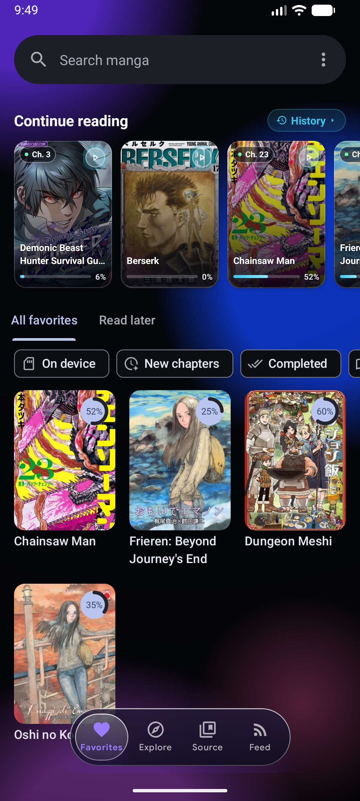
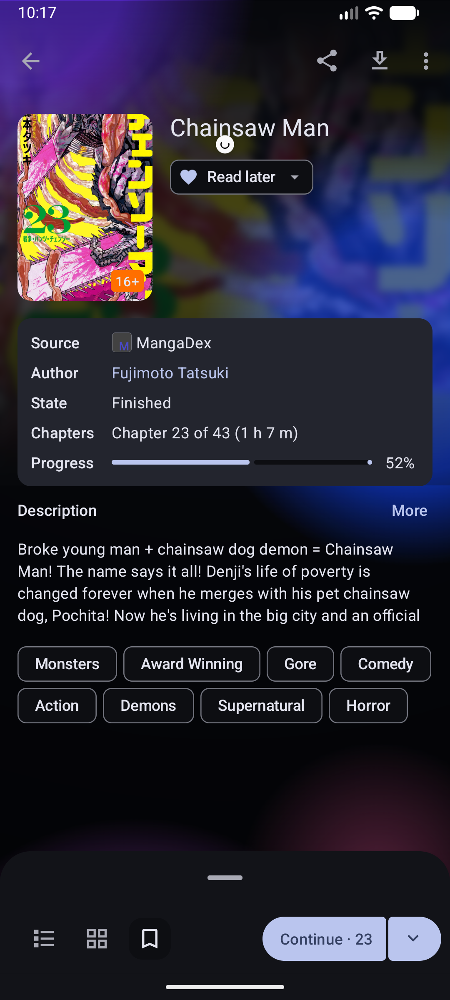
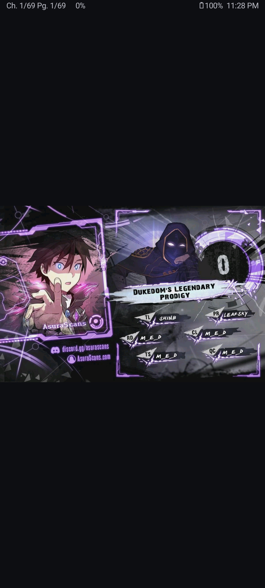
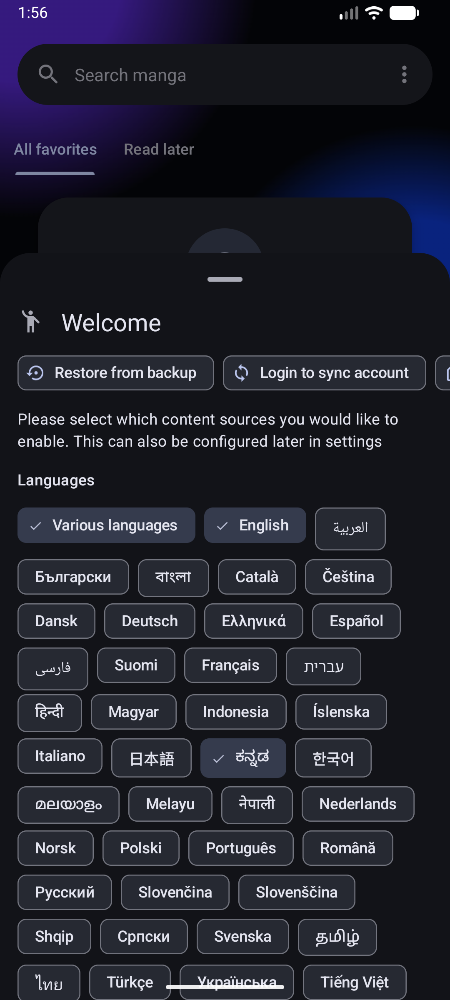
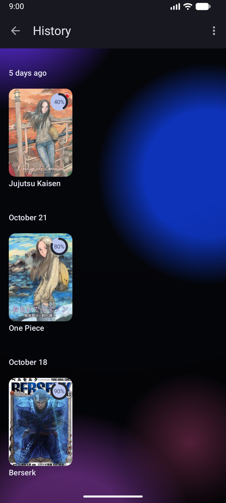
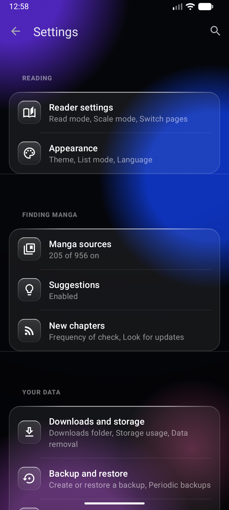

<div align="center">

**[Kotatsu-Redo](https://github.com/Kotatsu-Redo/Kotatsu-Redo) is a free and open-source manga reader for Android with built-in
online content sources. The main goal of the fork is to make the best reading manga app.**

 [](https://discord.gg/sfPJSQNxfW) [](https://github.com/KotatsuApp/Kotatsu/blob/devel/LICENSE)

### Key Enhancements & Differences from Original Kotatsu

**Why Kotatsu-Redo?** Kotatsu-Redo addresses the biggest friction points in modern manga & manhwa reading:

- 🌟 **Continue Reading Hero Rail**: An ambient, dynamic-palette hero carousel on your Favorites tab showing current progress, chapter badges, and instant one-tap resume without digging through History.
- ⚡ **New Chapters Rail with Quick Dismiss**: Unread chapter updates (`+1`, `+2`, etc.) surfaced directly on your shelf with category filtering and one-tap dismiss (`✕`), keeping your queue clean and organized.
- 🔄 **Smart Hybrid Scanlator Priority**: Automatic scanlator group detection and fallback. Set preferred scanlators (e.g., Asura Scans, Official) with automatic hybrid bridging—if another group drops the latest chapter first, it surfaces on top until your preferred group catches up. Zero duplicate chapter clutter!
- ☁️ **Two-Way AniList Progress Sync**: True bidirectional sync that pulls progress from AniList made on other devices, protects against regressions with a monotonic merger, and prevents scrobble echo loops.
- 💎 **Compact Floating Liquid Glass Navigation**: Modern 58dp floating pill navigation bar with frosted acrylic blur and active indicator pill, maximizing vertical reading real estate.
- 📑 **Optimized Category Flow**: Natural reading-first tab ordering (`Reading` → `Read later` → `Paused` → `All favourites` → `Dropped` → `Completed`).
- 🕒 **Date-Grouped History**: Reading history grouped intuitively by date ("Today", "Yesterday", and earlier).

### Main Features

<div align="left">

-   900+ working online manga sources ([kotatsu-parsers-redo](https://github.com/Kotatsu-Redo/kotatsu-parsers-redo)), with source presets, pinning and automatic mirror switching
-   Search across all your sources at once, by title, author or genre, with filters; sources that work best come first
-   Opt-in community features: comments and ratings on manga, plus shared source reliability that ranks search, Explore and the source catalog, with 🔥 on the most popular sources. No email or password, just a device key you can back up
-   Find the same manga on other sources and migrate your progress with Alternatives
-   Favorites in custom categories, reading history, bookmarks and incognito mode
-   Four reader modes: standard, right-to-left, vertical and Webtoon. Adjustable zoom, gaps, cropping, gestures, volume-key paging and an e-ink mode
-   New chapter checks with an updates feed, optional auto-download of new chapters, and recommendations with genre filters
-   Download manga to read offline (CBZ or folders) and open your own CBZ/ZIP archives
-   Sync favorites and history across devices, using your own sync server if you like
-   Scheduled automatic backups to a folder of your choice or to Telegram
-   Tracking with AniList, MyAnimeList, Kitsu and Shikimori, plus Discord Rich Presence
-   Reading statistics and reading time estimates
-   Home screen widgets for recent manga and your shelf
-   Network tools: proxy, DNS over HTTPS, image proxy and built-in CloudFlare handling
-   Password or fingerprint lock and screenshot protection
-   Material You design for phones, tablets and desktop, with a pure black dark theme
-   Supports Android 6.0 and newer

</div>

### In-App Screenshots

<div align="center">
    
    
    
    
    
    
</div>

<br>

<div align="center">
    
    
</div>

### Contributing

**📌 Pull requests are welcome, if you want:
See [CONTRIBUTING.md](https://github.com/Kotatsu-Redo/Kotatsu-Redo/blob/devel/CONTRIBUTING.md) for the guidelines**

### Certificate fingerprints

```plaintext
70:BD:84:07:13:01:84:5E:A3:D0:A4:E5:F3:3A:D2:41:0D:C9:FC:EB
```

```plaintext
FF:D9:C9:91:06:64:07:69:3C:F4:6E:46:9F:EA:DB:88:8D:33:FB:B2:FB:A7:7E:A3:79:B0:CA:12:A3:5C:66:1A
```

### License

[](http://www.gnu.org/licenses/gpl-3.0.en.html)

<div align="left">

You may copy, distribute and modify the software as long as you track changes/dates in source files. Any modifications
to or software including (via compiler) GPL-licensed code must also be made available under the GPL along with build &
install instructions.

</div>

### DMCA disclaimer

<div align="left">

The developers of this application do not have any affiliation with the content available in the app and does not store
or distribute any content. This application should be considered a web browser, all content that can be found using this
application is freely available on the Internet. All DMCA takedown requests should be sent to the owners of the website
where the content is hosted.

</div>
